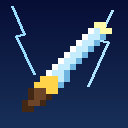
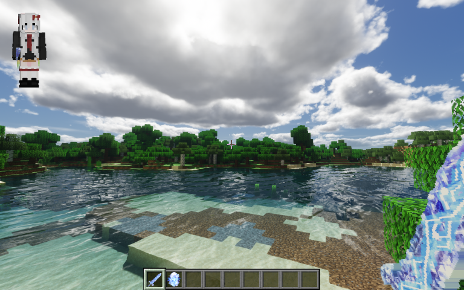
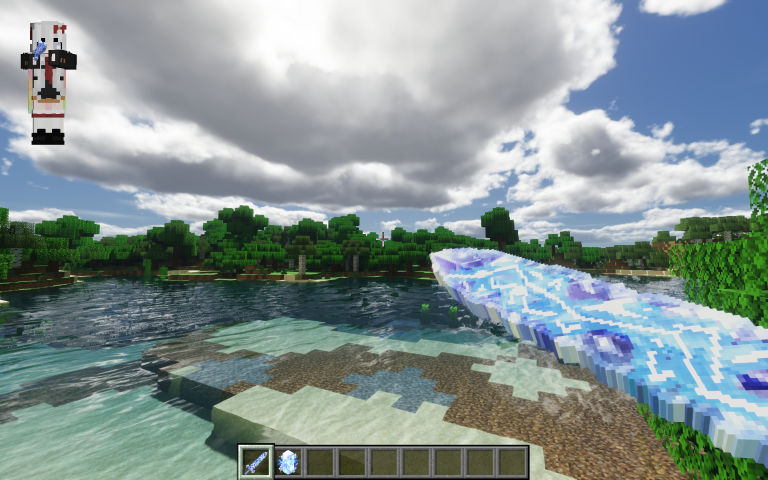
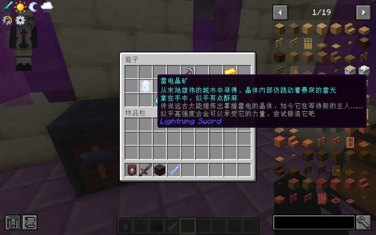
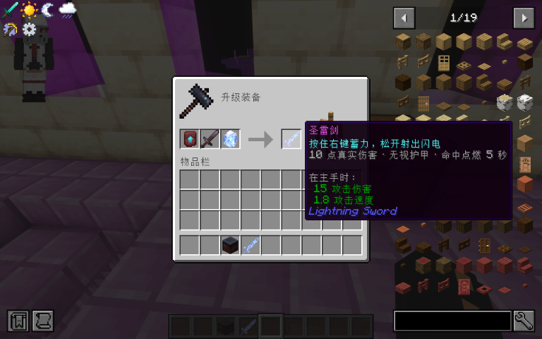

# 圣雷剑 Sacred Thunder Sword

一个 Fabric 模组（Minecraft **1.21/1.21.1/1.21.11**）：右键蓄力，松手射出一道**闪电**，
闪电会自动追踪准心附近的敌人，命中后点燃目标。



---

预览图：





## 玩法

| | |
|---|---|
| **右键按住** | 开始蓄力，剑身电火花环绕，剑切换到「瞄准」模型 |
| **蓄力不足 0.4 秒** | 松手无效果 |
| **蓄满 2 秒** | 射程达到最远 24 格（未蓄满按比例，最短 8 格） |
| **松手** | 剑尖射出一道闪电 |
| **命中伤害** | **10 点真实伤害**（无视护甲和护甲附魔，抗性提升仍然有效） |
| **命中效果** | **点燃目标 5 秒**（类似火焰附加）。点燃是在造成伤害**之前**施加的，所以被劈死的猪牛羊掉的是**熟肉** |
| **自动追踪** | 目标只要在准心射线 **1.5 格**横向范围内就会被自动锁定，隔着墙不锁 |
| **被方块挡住** | 闪电停在方块表面 |
| **每次发射** | 消耗 1 点耐久，10 tick 冷却 |
| **近战** | **15 点面板伤害 / 1.8 攻速**，和原版剑一样有**横扫之刃**效果 |

近战数值是用原版自己的 `SwordItem.createAttributeModifiers(ToolMaterials.NETHERITE, 10, -2.2F)` 生成的
（总伤害 = 玩家基础 1 + 10 + 下界合金材质 4 = 15，攻速 = 4.0 − 2.2 = 1.8），
所以属性修饰符 ID、附魔判定、属性 tooltip 全都和原版剑一致，**锋利等附魔正常生效**。

自动追踪的 1.5 格是**横向距离**而不是角度，所以远近手感一致。
太黏或太松改 `LightningBeam.AIM_ASSIST_RADIUS` 一个数就行。

闪电本体**不是粒子拼的**，而是把原版 `LightningEntityRenderer` 的几何生成代码（8 段随机游走 +
4 层丝带 + 同一个 `RenderLayer.getLightning()` 电光材质）照搬过来，只把坐标映射从「从地面竖直向上」
换成「沿飞行方向」。每帧形状会重新生成，所以它会噼啪闪动而不是一张静止贴图。

**第一人称护眼处理**：闪电离镜头不足 2.2 格的部分会被裁掉（第三人称不受影响），
并且全程**不使用** `ParticleTypes.FLASH`——那是原版全屏白闪粒子，生成在角色眼前非常刺眼。

## 合成

1. **雷电晶矿**：只在**末地城战利品箱**里，**每个箱子 8.8%** 概率。
   它是一块**晶体（物品）**。
2. **锻造台**：`下界合金剑` + `下界合金升级锻造模板` + `雷电晶矿` → **圣雷剑**。

## 安装

1. 安装 **Fabric Loader**（≥ 0.15.11）到 Minecraft **1.21.1**。
2. 把 [Fabric API](https://modrinth.com/mod/fabric-api) 放进 `mods/`。
3. 把 `lightning-sword-1.0.0.jar` 放进 `mods/`。

## 自己编译

需要 **JDK 21**。

```bash
set JAVA_HOME=C:\path\to\jdk-21   # Windows
./gradlew build                   # macOS / Linux
```

产物在 `build/libs/lightning-sword-1.0.0.jar`。

> 中国大陆下载依赖慢可以把仓库换成腾讯云/阿里云镜像；wrapper 也可以在
> `gradle/wrapper/gradle-wrapper.properties` 里把 `distributionUrl` 换成
> `https://mirrors.cloud.tencent.com/gradle/gradle-8.12-bin.zip`。
---powershell---
`.gradlew build` 即可。
----------------

## 代码结构

```
src/main/java/com/dsh/lightningsword/
├── LightningSwordMod.java          入口：注册物品、网络包、注入末地城战利品表
├── ModItems.java                   圣雷剑（原版属性写法）+ 雷电晶矿
├── LightningSwordItem.java         ★ 蓄力/松手发射、近战、闲置火花、维修、tooltip
├── LightningBeam.java              ★ 服务端：射线检测、1.5 格自动追踪、10 点真伤、先点燃再伤害
├── network/LightningBeamPayload.java  S2C 自定义包（起点/终点/种子）
└── client/
    ├── LightningSwordClient.java   客户端入口：收包、渲染事件、tick、Sodium 保活挂钩
    ├── BeamRenderer.java           ★ 照搬原版闪电几何，沿飞行方向绘制 + 近端裁剪（**别改写法**）
    ├── ClientBeams.java            正在显示的闪电（5 tick，逐帧换形状）
    └── SwordSprites.java           让剑/晶石的 8 帧动画在 Sodium 下继续跑（没 Sodium 就空转）

tools/
├── sword_source.png                你的剑原画
├── crystal_source.png              你的晶石原画
├── build_sword_texture.py          剑原画 → 8 帧动画剑贴图（叠流动电弧 + 轮廓辉光）
├── build_crystal_texture.py        晶石原画 → 去背景 + 裁切 → 8 帧动画晶石贴图
├── make_textures.py                图标 + 像素风备用贴图（有原画时自动跳过对应贴图）
├── gen_sword_model.py              ★ 把剑贴图轮廓挤出成 3D 模型（正面/背面/厚度）
├── preview_sword_model.py          模型结构自检 + 出预览图（不用进游戏）
├── PoseSim.java / PoseSolve.java   姿势数学模拟器与求解器（历史遗留，**当前已不在 tools/ 中**）
├── resourcepack-template/          资源包模板（只有贴图，不用编译）
└── patch_zipfs.py                  DSH 沙箱用的 jdk.zipfs 补丁
```

## 许可

MIT
